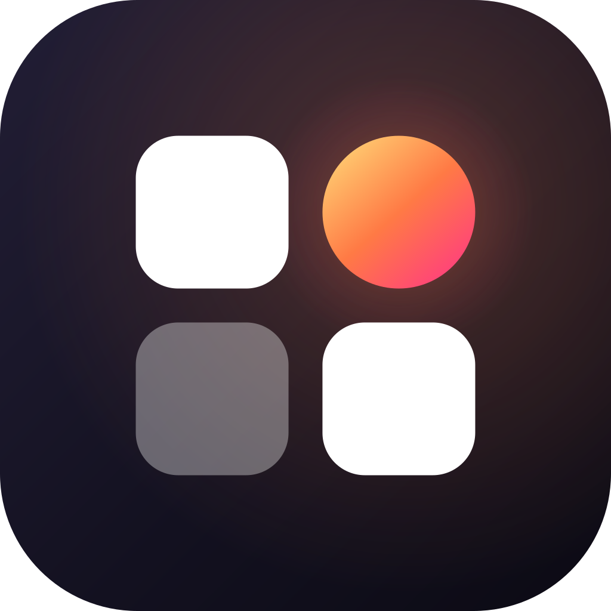
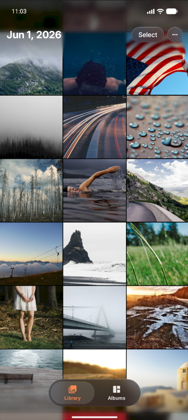
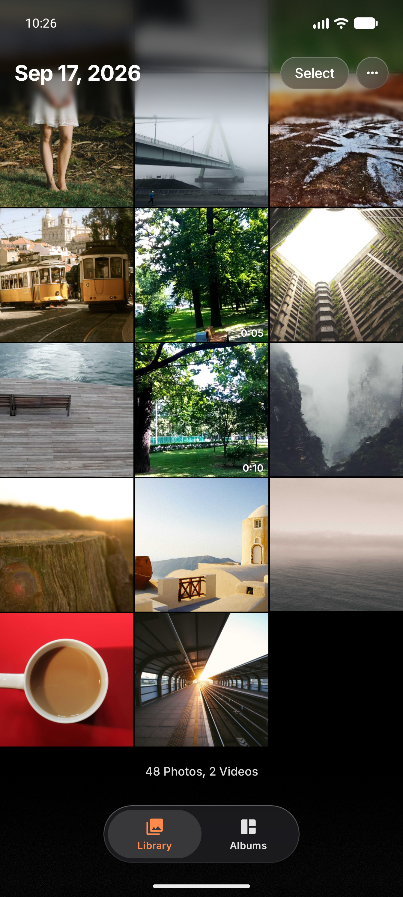
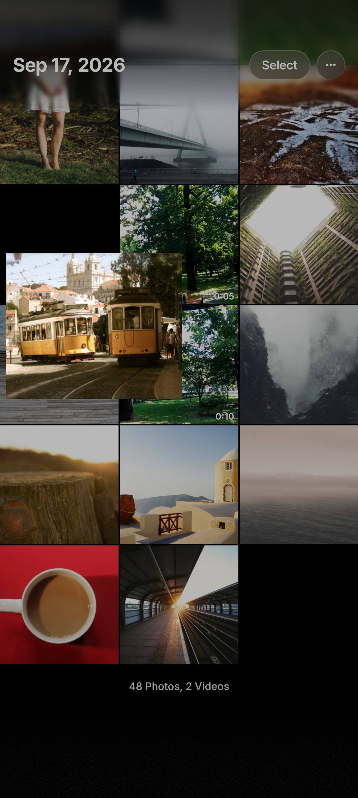
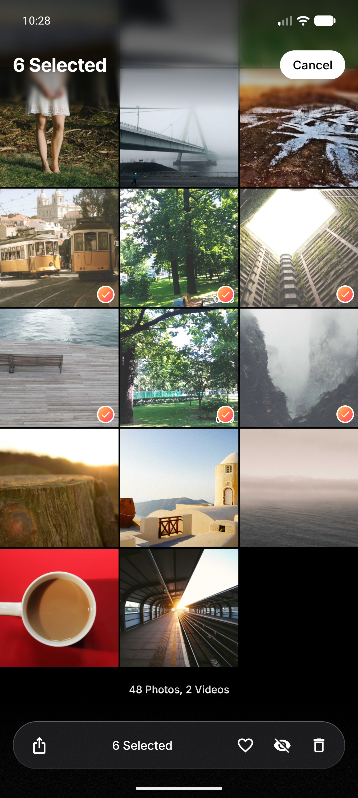
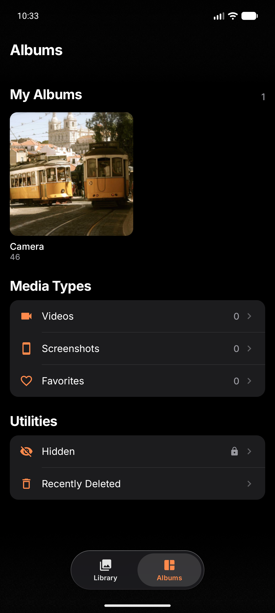

<p align="center">
  
</p>

<h1 align="center">Lumen</h1>
<p align="center">Every photo, beautifully kept.</p>

A clean, iOS-style photo gallery for Android. It reads your library through MediaStore,
works entirely on-device, and adds a locked **Hidden** album that nothing else on the phone can see.

<p align="center">
  
  
  
  
  
</p>

## Features

- **Library grid** — square tiles with hairline gaps, opens pinned to the newest row at the bottom.
  The title is the date under the bar and coarsens (day → month → year) as you pinch between 3, 5 and 8 columns.
- **Drag-select** — long-press and paint a range; the grid auto-scrolls at the edges.
- **Viewer** — opens by zooming out of the tapped cell; swipe down and it flies back into its slot.
  Pinch / double-tap zoom with tiled subsampling, swipe up for info, inline video with a scrubber.
- **Hidden** — copies the file into app-private storage, then removes the original from the shared library.
  Locked behind fingerprint / device PIN, re-locks when the app leaves the foreground, and blocks screenshots
  and the Recents preview. Unhide restores the original folder, name and date.
- **Albums** — device folders, Videos, Screenshots, Favorites, and Recently Deleted (the 30-day system trash).
- **Default viewer** — handles `VIEW` for `image/*` and `video/*`, camera `REVIEW` taps, and the
  `APP_GALLERY` selector. Pick Lumen → **Always** in Android's "Open with" sheet (or use the ••• menu).

## Build

Requirements: JDK 17+ (built with JDK 26), Android SDK with platform 37.

```bash
./gradlew assembleRelease
```

The release build is minified with R8 and signed with the debug key so it sideloads directly:

```bash
adb install -r app/build/outputs/apk/release/app-release.apk
```

Create `local.properties` with `sdk.dir=/path/to/Android/Sdk` if `ANDROID_HOME` isn't set.

## Permissions

| Permission | Why |
|---|---|
| `READ_MEDIA_IMAGES`, `READ_MEDIA_VIDEO`, `READ_MEDIA_VISUAL_USER_SELECTED` | Read the library (full or limited access). |
| `MANAGE_MEDIA` (optional, special access) | Lets hide / delete / favorite skip Android's per-action confirmation sheet. |
| `USE_BIOMETRIC` | Unlock the Hidden album. |

No network permission. Nothing leaves the device.

## Notes on Hidden

- Hidden files live in the app's internal storage (`files/vault/`). The manifest sets
  `hasFragileUserData`, so uninstalling asks whether to keep app data — decline and hidden photos are deleted.
- Copies already backed up to a cloud service (e.g. Google Photos) are outside Lumen's reach.
- With no screen lock configured, the album opens without a prompt and says so.

## Project layout

```
app/src/main/java/app/lumen/photos/
├── MainActivity.kt          launch modes: library, camera review, standalone "Open with"
├── GalleryViewModel.kt      library/trash/hidden state, actions, consent broker
├── data/
│   ├── MediaRepository.kt   MediaStore queries, change observer, trash/delete/favorite requests
│   ├── Vault.kt             Hidden storage: stage → commit, restore to MediaStore
│   └── Thumbs.kt            Coil fetcher backed by MediaProvider's thumbnail cache
└── ui/
    ├── MediaGrid.kt         grid, pinch-to-zoom columns, drag-select
    ├── GridScreen.kt        top bar, selection bar, empty states
    ├── Viewer.kt            zoom transition, pager, swipe-to-dismiss, info card
    ├── VideoPage.kt         ExoPlayer page + scrubber
    ├── AlbumsScreen.kt, Hidden.kt, Onboarding.kt, Root.kt
    └── Glass.kt, Icons.kt, theme/
```

## Stack

Kotlin · Jetpack Compose · AGP 9.4 · Coil 3 · [Telephoto](https://github.com/saket/telephoto) ·
[Haze](https://github.com/chrisbanes/haze) · Media3 ExoPlayer · AndroidX Biometric

## Credits

- [Inter](https://github.com/rsms/inter) typeface — SIL Open Font License 1.1 ([licenses/Inter-OFL.txt](licenses/Inter-OFL.txt)).
- Icon glyphs adapted from Material Icons (Apache 2.0).
- Screenshot photos are placeholder images from https://picsum.photos (Unsplash).
